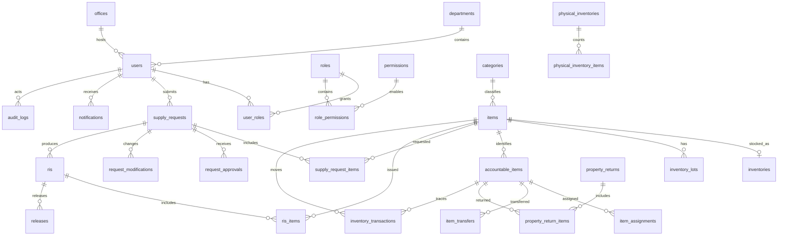

# SOIMS Database / ERD Reference

Date: 2026-10-02
Status: Approved reference; migrations implemented in Phase 4
Database target: MySQL/MariaDB

## 1. Design Decisions

- Use UUIDs for externally exposed business documents and numeric BIGINT primary keys for internal rows where Laravel conventions are useful.
- Keep organization units in `departments` and `offices`; a user may belong to one primary office and department while transaction records retain their historical references.
- Use `roles`, `permissions`, `role_permissions`, and `user_roles` so role vocabulary can be approved without redesigning authorization tables.
- Store workflow states as controlled strings in the first implementation. Transition rules belong in services and policies, not database triggers.
- Store quantities as DECIMAL(14,3) and prices/amounts as DECIMAL(14,2).
- Use soft archive/status fields for catalog and identity records where history must remain readable. Do not cascade-delete transaction history.
- Use UTC timestamps in the database and display local campus time in the application.
- Use JSON snapshots in audit and modification records for before/after values, with indexed foreign keys to the related record.
- Enforce unique property numbers and barcodes for accountable units. A consumable catalog item may have stock lots and movements but is not represented as one accountable unit per piece.

## 2. Entity Relationship Overview

## 3. Identity and Organization

### `users`

`id`, `name`, `username` unique, `email` nullable unique, `password`, `profile_image_path` nullable, `department_id` nullable, `office_id` nullable, `is_active`, `email_verified_at` nullable, `last_login_at` nullable, timestamps, soft delete timestamp.

### `roles`

`id`, `key` unique, `name`, `description` nullable, `is_active`, timestamps.

### `permissions`

`id`, `key` unique, `name`, `module`, `description` nullable, timestamps.

### `user_roles`

`user_id`, `role_id`, `assigned_by`, `assigned_at`, `revoked_at` nullable. Unique active assignment per user and role.

### `role_permissions`

`role_id`, `permission_id`, `assigned_by`, timestamps. Unique role/permission pair.

### `departments`

`id`, `code` unique, `name`, `type` (academic/non_academic/administrative), `is_active`, timestamps, soft delete timestamp.

### `offices`

`id`, `code` unique, `name`, `department_id` nullable, `is_active`, timestamps, soft delete timestamp.

## 4. Catalog and Inventory

### `categories`

`id`, `code` unique, `name`, `description` nullable, `is_active`, timestamps, soft delete timestamp.

### `items`

`id`, `stock_no` unique, `name`, `description` nullable, `category_id`, `classification` (consumable/accountable), `unit_of_measure`, `default_unit_price` DECIMAL(14,2) nullable, `reorder_level` DECIMAL(14,3) nullable, `is_active`, timestamps, soft delete timestamp.

### `inventories`

One current balance per item and stock location: `id`, `item_id` unique, `location` nullable, `quantity_on_hand` DECIMAL(14,3), `quantity_reserved` DECIMAL(14,3), `quantity_available` is calculated by service/query, `last_counted_at` nullable, timestamps.

### `inventory_lots`

Optional lot-level detail: `id`, `item_id`, `lot_no` nullable, `received_date`, `expiration_date` nullable, `unit_cost` DECIMAL(14,2) nullable, `quantity_on_hand` DECIMAL(14,3), `supplier_id` nullable, `is_active`, timestamps.

### `suppliers`

`supplier_id`, `name`, `address` nullable, `contact_person` nullable, `phone` nullable, `email` nullable, `tax_identifier` nullable, `is_active`, timestamps, soft delete timestamp.

### `inventory_transactions`

Immutable movement ledger: `id`, `item_id`, `inventory_lot_id` nullable, `accountable_item_id` nullable, `type` (receipt/issue/release/return/adjustment/transfer), `quantity` DECIMAL(14,3), `unit_cost` DECIMAL(14,2) nullable, `reference_type`, `reference_id`, `performed_by`, `reason` nullable, `occurred_at`, timestamps. Inbound movements such as receipts use positive quantities; outbound movements such as issues and releases use negative quantities. Services apply this sign convention when recording immutable ledger entries.

## 5. Supply Requests and Approval

### `supply_requests`

`id`, `request_no` unique, `requestor_id`, `department_id` nullable, `office_id` nullable, `request_type` (academic/non_academic), `purpose`, `status`, `submitted_at`, `confirmed_at` nullable, `completed_at` nullable, `rejected_at` nullable, `rejection_reason` nullable, timestamps.

### `supply_request_items`

`id`, `supply_request_id`, `item_id`, `requested_quantity` DECIMAL(14,3), `confirmed_quantity` DECIMAL(14,3) nullable, `issued_quantity` DECIMAL(14,3) default 0, `unavailable_quantity` DECIMAL(14,3) default 0, `unit_price_snapshot` DECIMAL(14,2) nullable, `remarks` nullable, timestamps. Original requested quantity is immutable.

### `request_approvals`

`id`, `supply_request_id`, `approver_id`, `role_snapshot`, `decision` (approved/rejected/returned), `comments` nullable, `decided_at`, timestamps.

### `request_modifications`

`id`, `supply_request_id`, `supply_request_item_id` nullable, `field_name`, `previous_value` JSON, `new_value` JSON, `reason`, `modified_by`, `modified_at`, timestamps.

## 6. Receiving and Issuance

### `receivings`

`id`, `receiving_no` unique, `supplier_id` nullable, `received_by`, `received_at`, `reference_no` nullable, `remarks` nullable, status, timestamps.

### `receiving_items`

`id`, `receiving_id`, `item_id`, `inventory_lot_id` nullable, `quantity` DECIMAL(14,3), `unit_cost` DECIMAL(14,2) nullable, `expiration_date` nullable, `classification_snapshot`, timestamps.

### `ris`

Formal issuance document: `id`, `ris_no` unique, `revision_no` default 0, `supply_request_id` nullable, `entity_name`, `fund_cluster` nullable, `division` nullable, `office` nullable, `responsibility_center_code` nullable, `purpose`, `requested_by` nullable, `approved_by` nullable, `issued_by` nullable, `received_by` nullable, `received_printed_name` nullable, `received_designation` nullable, `issued_at` nullable, `received_at` nullable, `status`, timestamps.

### `ris_items`

`id`, `ris_id`, `item_id`, `stock_no_snapshot`, `unit_snapshot`, `description_snapshot`, `requested_quantity` DECIMAL(14,3), `issue_quantity` DECIMAL(14,3), `unit_price` DECIMAL(14,2), `amount` DECIMAL(14,2), `stock_available` boolean nullable, `remarks` nullable, timestamps.

### `releases`

`id`, `ris_id`, `released_by`, `received_by` nullable, `released_at`, `status`, `notes` nullable, timestamps.

## 7. Accountable Items, Assignment, and Return

### `accountable_items`

One row per physical accountable unit: `id`, `item_id`, `property_no` unique, `barcode` unique, `serial_no` nullable unique, `date_acquired` nullable, `unit_value` DECIMAL(14,2) nullable, `status`, `current_department_id` nullable, `current_office_id` nullable, `current_location` nullable, `current_user_id` nullable, `received_at` nullable, timestamps, soft delete timestamp.

### `item_assignments`

`id`, `accountable_item_id`, `assigned_to_user_id` nullable, `assigned_to_department_id` nullable, `assigned_to_office_id` nullable, `location`, `assigned_by`, `assigned_at`, `released_at` nullable, `release_reason` nullable, `status`, timestamps.

### `item_transfers`

`id`, `accountable_item_id`, `from_assignment_id` nullable, `to_assignment_id` nullable, `from_location` nullable, `to_location` nullable, `transferred_by`, `reason` nullable, `transferred_at`, timestamps.

### `property_returns`

`id`, `prs_no` unique, `document_no` nullable, `issue_no` nullable, `revision_no` default 0, `office_name`, `purpose` (repair/disposal/returned_to_stock/other), `received_from` nullable, `returned_to` nullable, `end_user` nullable, `certification` nullable, `returned_by`, `received_at`, `status`, timestamps.

### `property_return_items`

`id`, `property_return_id`, `accountable_item_id`, `property_no_snapshot`, `description_snapshot`, `quantity`, `unit_value` DECIMAL(14,2) nullable, `remarks` nullable, timestamps.

## 8. Physical Inventory and System Records

### `physical_inventories`

`id`, `inventory_no` unique, `conducted_by`, `department_id` nullable, `office_id` nullable, `conducted_at`, `status`, `remarks` nullable, timestamps.

### `physical_inventory_items`

`id`, `physical_inventory_id`, `item_id` nullable, `accountable_item_id` nullable, `article`, `description`, `date_acquired` nullable, `old_property_no` nullable, `new_property_no` nullable, `unit_of_measure` nullable, `unit_value` DECIMAL(14,2) nullable, `quantity_per_property_card` DECIMAL(14,3), `quantity_per_physical_count` DECIMAL(14,3), `shortage_quantity` DECIMAL(14,3) default 0, `overage_quantity` DECIMAL(14,3) default 0, `remarks` nullable, timestamps.

### `notifications`

`id`, `user_id` nullable, `role_key` nullable, `type`, `title`, `message`, `related_type` nullable, `related_id` nullable, `read_at` nullable, timestamps.

### `audit_logs`

`id`, `user_id` nullable, `role_snapshot` nullable, `action`, `module`, `record_type` nullable, `record_id` nullable, `previous_value` JSON nullable, `new_value` JSON nullable, `reason` nullable, `ip_address` nullable, `user_agent` nullable, `occurred_at`, timestamps. Audit rows are append-only at the application level.

## 9. Key Integrity Rules

- Foreign keys use restrictive behavior for historical transaction references; archive/status is preferred over deletion.
- Request line items cannot be deleted after submission; changes are represented by modification records.
- Issuance snapshots preserve the item description, unit, price, and quantities used on the printed document.
- Inventory balances are updated only through transactional services that also append movement records.
- Accountable assignments close the previous assignment before creating the next current assignment.
- A property return changes accountable-item status and assignment history in one transaction.
- Physical count discrepancies do not automatically change stock; an authorized adjustment is a separate action.
- Unique indexes are required for business document numbers, stock numbers, property numbers, barcodes, and active role assignments.

## 10. Official Architecture Mapping

- `inventory_transactions` is the immutable source for Stock Card and Stock Movement reports.
- `inventory_lots` is the expiration-tracking source for lot number, expiration date, quantity, and receiving reference.
- `item_assignments` and `item_transfers` are the accountability history source; historical rows are retained.
- `audit_logs` is the append-only audit destination; audit event services must be added before transactional modules are complete.
- The role catalog contains exactly five roles: Supply Administrator, Supply Sub-Administrator, Administrative Officer, DAA, and Programs / Departments.
- Procurement is not a role in the approved architecture.

## 11. Framework Scaffolding Note

Laravel's default `users`, cache, jobs, and sessions migrations exist on disk as framework scaffolding. They were not applied to the MySQL database. During Phase 4, they must either be adapted to the approved SOIMS identity/session strategy or replaced deliberately; they must not be silently mixed with the final SOIMS schema.

## 12. Deferred Decisions Before Transactional Modules

- Finalize status values and allowed transitions per workflow module.
- Approve document numbering and revision rules.
- Approve whether `inventory_lots` is mandatory for expiring consumables.
- Approve exact deletion/archive policy and retention period for audit logs.
- Approve whether signatures are stored as files, metadata, or external records.
- Approve the final migration order and whether framework cache/jobs tables are needed.

Recommended next phase: implement the updated module sequence beginning with Departments, Offices, Categories, and Items.
